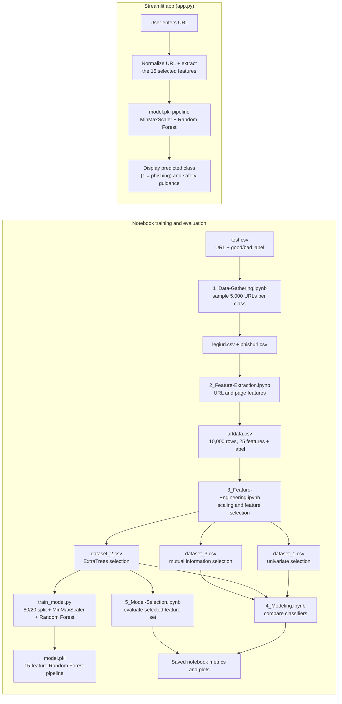

# Phishing URL Detection


A Streamlit application and a set of Jupyter notebooks for extracting URL
features, training phishing classifiers, and comparing their performance.

> **Research/demo notice:** This project is not a security product. Model
> predictions are estimates and must not be used as the sole basis for deciding
> whether a website is safe.

## Project architecture

The notebooks prepare data and evaluate several models. `train_model.py`
recreates the selected Random Forest model as a pipeline with MinMax scaling.
The Streamlit app extracts the pipeline's 15 URL features and uses the
checked-in `model.pkl` for inference.



### Main components

| Component | Purpose |
| --- | --- |
| `app.py` | Streamlit URL input, Random Forest inference, and result/feature-importance display. |
| `features_extraction.py` | `Extractor` computes the 15 URL-derived features in the exact order expected by the selected model. |
| `train_model.py` | Reproduces the selected training split and saves a scikit-learn pipeline with MinMax scaling and Random Forest. |
| `model.pkl` | Serialized scikit-learn pipeline (MinMax scaling + Random Forest), fitted to the 15 ordered columns in `dataset_2.csv`. |
| `extractor.pkl` | Additional serialized notebook artifact; it is not loaded by `app.py`. |
| `1_Data-Gathering.ipynb` | Samples labeled URLs from `test.csv` and writes the two URL lists. |
| `2_Feature-Extraction.ipynb` | Extracts features and creates the combined `urldata.csv` dataset. |
| `3_Feature-Engineering.ipynb` | Scales data and builds three feature-selected datasets. |
| `4_Modeling.ipynb` | Compares classifiers on the full and selected feature sets. |
| `5_Model-Selection.ipynb` | Evaluates the ExtraTrees-selected dataset and compares models in more detail. |
| `main.ipynb` | Earlier/combined experimentation notebook; the numbered notebooks describe the staged workflow. |

### Demo dashboard

The Streamlit interface includes a URL scanner, a live phishing-score gauge,
and a global Random Forest feature-importance chart. The analytics tabs show
current-session scan summaries plus the classifier's held-out accuracy,
precision, recall, F1 score, confusion matrix, and training-set class balance.
The Model insights tab also presents static research-summary metrics separately
from the checked-in Random Forest's calculated holdout results; the
classifier-comparison chart is omitted. Session history is temporary and stores
hostnames rather than full URLs.

## Data and artifacts

The numbered notebooks use a balanced 10,000-row sample: 5,000 legitimate and
5,000 phishing URLs.

| File(s) | Contents |
| --- | --- |
| `test.csv` | Source URL/label data used by the gathering notebook (`good` and `bad` labels). |
| `legiurl.csv`, `phishurl.csv` | 5,000 sampled URLs for each class. |
| `legitimate.csv`, `phishing.csv` | Per-class feature tables produced during feature extraction. |
| `urldata.csv` | Combined 10,000-row feature dataset used by the modeling notebooks. |
| `dataset_1.csv`, `dataset_2.csv`, `dataset_3.csv` | Feature-selection outputs: univariate, ExtraTrees, and mutual-information selection, respectively. |
| `full.csv` | Additional tabular data; it is not part of the numbered notebook pipeline described above. |
| `image_green_tick.png`, `image_red_cross.png` | Result images referenced by the Streamlit app. |
| `model_loss.png` | Saved model/experiment visualization. |
| `REEARCH PAPER.pdf` | Accompanying research paper; source for the paper-reported accuracy table below. |
| `IJNTI 230750_Certificate.pdf` | Certificate document; it does not provide model evaluation results. |

## Evaluation

### Results recorded in `5_Model-Selection.ipynb`

The following values are from the notebook's saved output for `dataset_2.csv`
(ExtraTrees-selected features). The notebook uses an 80/20 train/test split with
`random_state=42`; the held-out test set contains 2,000 rows. Precision, recall,
and F1 are calculated for class `1` (the app treats class `1` as phishing).
Values are transcribed from the notebook output and have not been independently
re-run as part of this README update.

| Classifier | Accuracy | Precision | Recall | F1 |
| --- | ---: | ---: | ---: | ---: |
| Stacking classifier | 0.8200 | 0.8097 | 0.8310 | 0.8202 |
| Random Forest | 0.8155 | 0.8061 | 0.8249 | 0.8154 |
| XGBoost | 0.8095 | 0.7996 | 0.8198 | 0.8096 |
| K-Nearest Neighbors | 0.7865 | 0.7865 | 0.7794 | 0.7829 |
| Gradient Boosting | 0.7785 | 0.7778 | 0.7723 | 0.7750 |
| Decision Tree | 0.7715 | 0.7751 | 0.7571 | 0.7660 |
| AdaBoost | 0.7595 | 0.7764 | 0.7206 | 0.7475 |
| Support Vector Machine | 0.7090 | 0.7464 | 0.6225 | 0.6788 |
| Logistic Regression | 0.7030 | 0.7345 | 0.6245 | 0.6751 |
| Gaussian Naive Bayes | 0.6645 | 0.9490 | 0.3391 | 0.4996 |

The notebook selects the stacking classifier as its top result by accuracy,
while the demo app uses Random Forest for live inference. These are notebook
experiment results, not a guarantee of real-world phishing-detection
performance. The notebook's ROC plotting code passes hard class predictions
to the ROC/AUC functions; its plotted ROC curves should not be interpreted as
probability-score ROC analysis.

### Accuracies reported in the accompanying paper

The paper reports accuracy values for individual algorithms in its algorithms
section (printed page a72 / PDF page 5). It does not report precision, recall,
or F1 alongside these values.

| Classifier | Paper-reported accuracy |
| --- | ---: |
| Random Forest | 81.3% |
| XGBoost | 80.9% |
| Decision Tree | 77.2% |
| Gradient Boosting | 77.9% |
| AdaBoost | 75.95% |
| Support Vector Machine | 70.9% |
| Logistic Regression | 70.3% |
| Gaussian Naive Bayes | 66.4% |

Citation: Punit Gavali, "PhishProbe - Phishing Site Detection Using ML: A Novel
Approach Using Generative AI and Streamlit," *International Journal of Novel
Trends and Innovation*, vol. 2, issue 11, November 2024, paper IJNTI2411009.
The paper values above are reported results, distinct from the project
notebook's saved outputs; differences between them should not be treated as a
reproducibility comparison without matching datasets and experimental settings.

### Static showcase figures displayed in the dashboard

These static figures were supplied in the project resume summary and are shown
separately from the app's calculated Random Forest holdout metrics. They are
presented for showcase context and have not been independently reproduced
here.

The summary identifies Random Forest as the best single classifier (81.25%
accuracy). It reports 82.00% accuracy, 80.70% precision, and 81.90% recall for
the combined Stacking Classifiers + Extra Trees result. The ensemble values
are static research figures, not measurements from URL scans or the
checked-in `model.pkl`.

## Quick start

The app is built with Streamlit. From the repository root, install the declared
requirements and launch it:

```bash
python -m pip install -r requirements.txt
streamlit run app.py
```

The checked-in `model.pkl` is ready to use. To retrain it from `dataset_2.csv`
with the project's fixed 80/20 split:

```bash
python train_model.py
```

Run the app locally at `http://localhost:8501`. The model pipeline expects
scikit-learn 1.8.0, which is pinned in `requirements.txt` for pickle
compatibility. The other dependency versions are not pinned.

## Limitations

- The app uses URL structure features only; it does not inspect page content.
  HTTPS presence alone does not establish that a site is safe.
- The older `Extractor.extract()` method can request a URL for page-related
  features, but the Streamlit app does not call it.
- Evaluation values are from the supplied notebook outputs and accompanying
  paper, not a recent independent benchmark. Datasets and threat behavior can
  change over time.
- Pickle artifacts should only be loaded from trusted sources.
- This project is for research and educational use. It is not a substitute for
  browser protections, security review, or trusted threat-intelligence tools.
